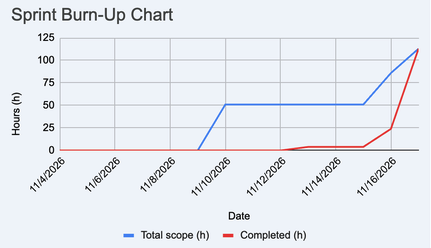
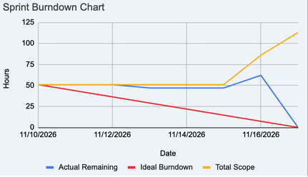

# Sprint 3 Report

**LeetBattle** · November 16, 2026

---

## Actions to stop doing

- **Planning tasks that end up blocked.** Plan tasks better so there are fewer blocked tasks. During this sprint, a few tasks relied on the game socket, which was not implemented until later in the sprint.
- **Forgetting the workflow.** Since this is the first time we are using it, mistakes are expected, but to keep the commit history and everything else clean, everyone should be more careful about following the workflow.

## Actions to start doing

- **Write a task.md file and commit it before beginning work.** This goes hand in hand with the "forgetting the workflow" point above.
- **Document the project better.** There has been a large gap in overall documentation since Sprint 1. We need to go back and document everything that has been done, and stay on top of documenting features from new tasks as they are implemented.
- **Space progress out more.** Aim for smaller, incremental progress daily rather than large blocks of work hours all at once (see the burn-up charts).

## Actions to keep doing

- **Frequent Scrum meetings.** We have 3+ Scrum meetings per week. One longer work session could be useful, but this is working for now.
- **Writing test cases for all components.** The whole team has been using agent-driven TDD well.

---

## Work completed / not completed

### Completed

- Start Match
- Collaboration
- Communication
- Team Score
- UI/UX
- In-Game

### Not completed

- None

---

## Work completion rate

### Sprint 3 (Nov 4–17)

| Metric | Value |
|---|---|
| Days in the sprint | 14 |
| User stories completed | 6 (Start Match, Collaboration, Communication, Team Score, UI/UX, In-Game) |
| Ideal work hours completed | 109 of 113 planned |
| User stories / day | 0.429 |
| Ideal hours / day | 7.79 |

### Averages across all sprints to date (Sprints 2 and 3)

| Metric | Value |
|---|---|
| User stories / day | 0.321 |
| Ideal hours / day | 4.18 |

---

## Burn-up and burndown charts

### Burn-up

### Burndown

